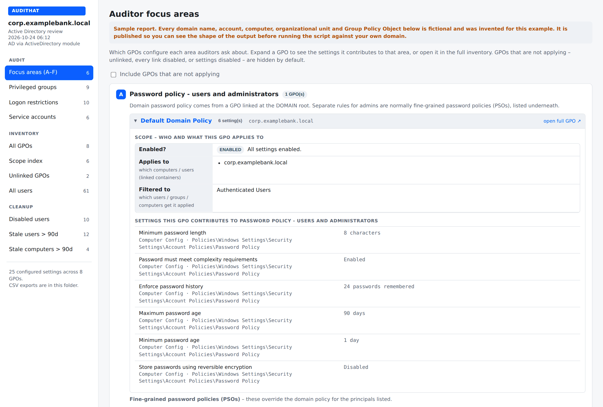
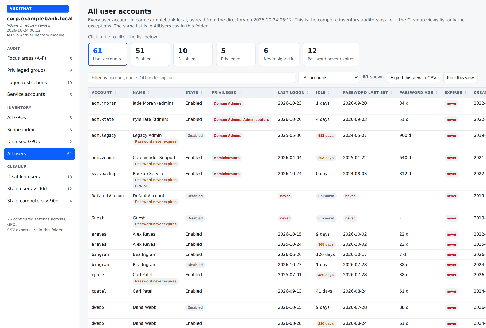
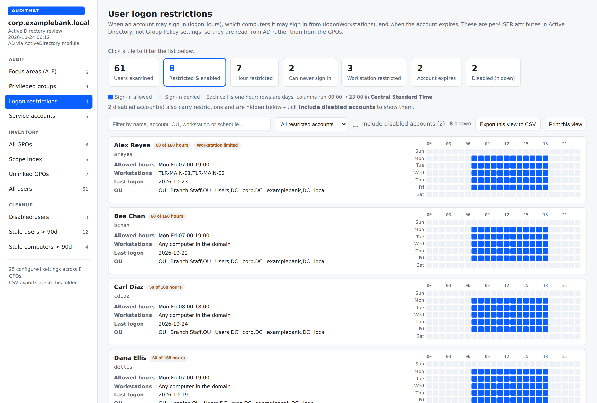
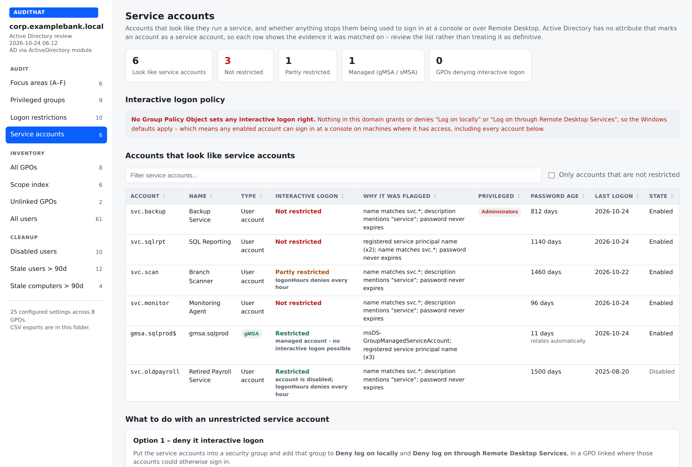
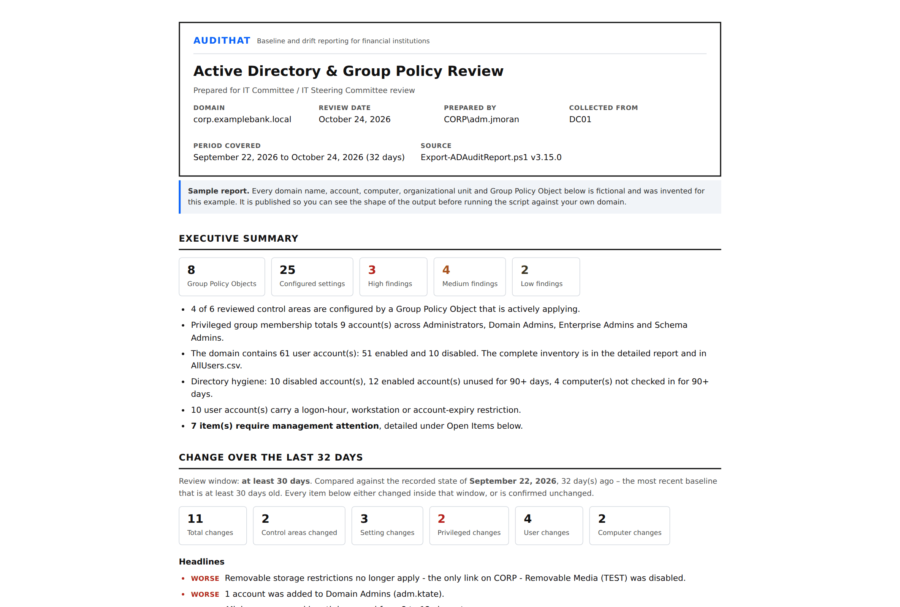
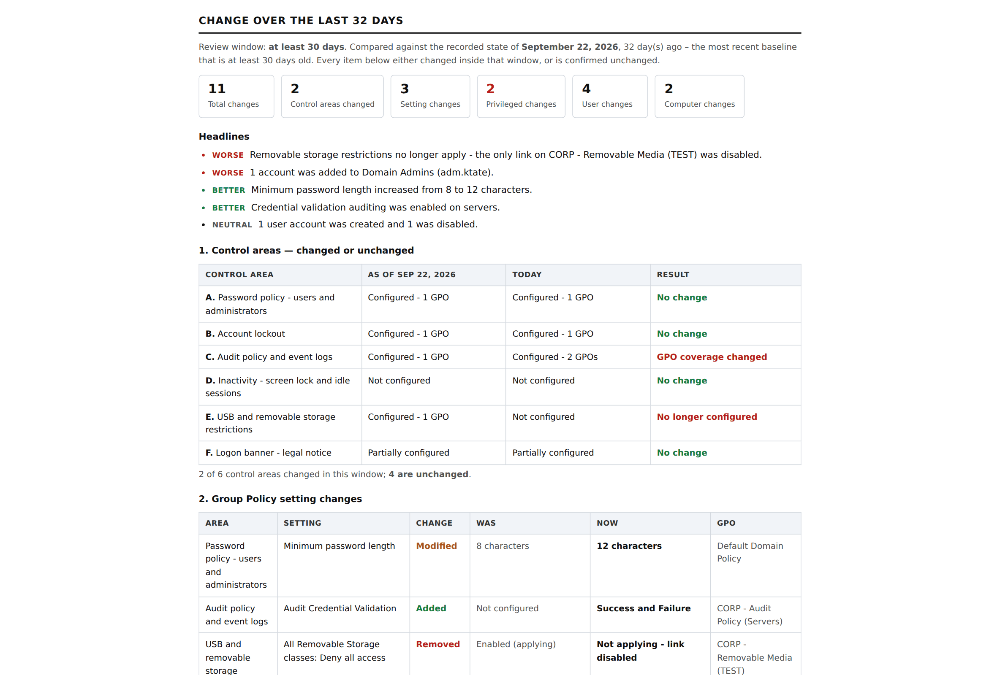
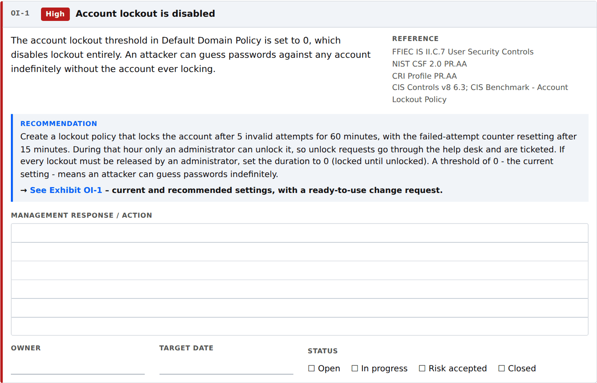
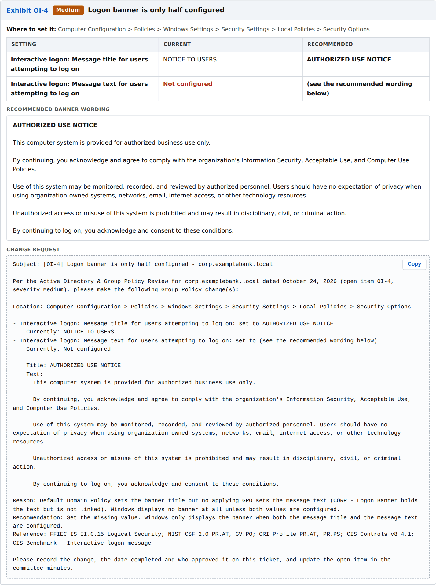

# AuditHat — Active Directory & Group Policy Audit Report for IT Committees

**One PowerShell script. No install, no modules to download, no agent, no database, no cloud service.**
Copy `Export-ADAuditReport.ps1` to a domain controller, run it, and you get a complete Active Directory
and Group Policy audit report plus a print-ready **IT Committee report** — with change tracking,
management response boxes, and control mapping to **FFIEC**, **NIST CSF 2.0**, the **CRI Profile** and
**CIS Controls v8**.

Built for community banks, credit unions and the MSPs that serve them — but it runs against any
Active Directory domain.

| | |
|---|---|
| **What it is** | A single `.ps1` file. Nothing else is needed. |
| **What it does** | Read-only audit of every GPO, every user, privileged groups, service accounts and logon restrictions |
| **What you get** | Two self-contained HTML reports + CSV exports you can hand to an auditor |
| **Change tracking** | Differential tables over a rolling window (default 30 days), not "since last run" |
| **Version** | **3.15.0** — script last updated 2026-10-15. See [Version history](#version-history). |
| **License** | Apache 2.0 |

---

## Why this exists

Every bank and credit union IT examination asks the same questions about Active Directory. Who has
administrative access, and did it change since the last review? Is account lockout turned on? How long
before an idle session locks? Can service accounts log on at a console? Which accounts are stale? Is the
logon banner actually displayed? Examiners from the FFIEC agencies, the NCUA, state regulators and
third-party IT auditors ask for this evidence every cycle, and most institutions rebuild it by hand each
time from GPMC screenshots and ADUC exports.

This script was written to answer those questions in one pass, in the format auditors and examiners
expect, with the control citations they look for already attached. Run it before the exam and hand the
detailed review to the auditor. Run it monthly and the IT Committee report drops straight into the
committee packet, with change tracking and management response boxes ready for the minutes. It saves
hours every review cycle and gives the committee a consistent document to approve.

---

## See it before you run it

Two complete sample reports are in [`samples/`](samples/). Every domain, account, computer and GPO in
them is fictional.

| Sample | Download |
|---|---|
| **Detailed review** — the left-nav application | [`samples/sample-detailed-report.html`](samples/sample-detailed-report.html) |
| **IT Committee report** — the print-ready packet | [`samples/sample-committee-review.html`](samples/sample-committee-review.html) |

> Download the file and open it in any browser. Both samples are fully self-contained — no server,
> no internet connection, no dependencies. They are exactly what the script writes to disk.

### The detailed review

Auditor focus areas — which GPO configures each thing an examiner asks about, and whether it is
actually applying:



The complete user inventory auditors ask for, with clickable filter tiles, search, CSV export and a
print button that drops the sidebar:



Per-user logon restrictions — logon hours drawn as a 7×24 grid, workstation limits and account expiry:



Service account review — what looks like a service account, and whether anything actually stops it
signing in at a console or over RDP:



### The IT Committee report

A separate, print-ready document for the IT Committee / IT Steering Committee packet:



**Change tracking** — five differential tables covering control areas, Group Policy settings,
privileged group membership, user accounts and computer accounts. Each one says plainly what changed
**and what did not**:



Every open item carries a recommendation and a ruled **management response / action** box — type into
it in the browser, or print it and write in it:



And every open item has an exhibit at the back with current vs recommended settings and a change
request written so it pastes straight into a ticket:



---

## Step-by-step: running your first report

### 1. Get the script

Download [`Export-ADAuditReport.ps1`](Export-ADAuditReport.ps1) — click the file above, then the
**Download raw file** button. That one file is the whole tool.

### 2. Copy it to a domain controller

Or to any domain-joined machine with **RSAT: Group Policy Management Tools** and **RSAT: Active
Directory module for Windows PowerShell** installed. A domain controller already has both.

Put it somewhere simple, like `C:\Temp\`.

### 3. Open PowerShell as an administrator

Right-click **Windows PowerShell** → **Run as administrator**.

### 4. Unblock the file

Windows marks files downloaded from the internet. Clear that flag once:

```powershell
Unblock-File C:\Temp\Export-ADAuditReport.ps1
```

### 5. Allow the script to run in this session

This changes nothing permanently — it applies only to the PowerShell window you have open:

```powershell
Set-ExecutionPolicy -Scope Process -ExecutionPolicy Bypass
```

### 6. Run it

```powershell
cd C:\Temp
.\Export-ADAuditReport.ps1
```

That is it. No parameters are required — it discovers the domain it is joined to.

### 7. Open the reports

Everything lands in a timestamped folder under `C:\GPOReports\`:

```
C:\GPOReports\AD-Report-corp.yourbank.local-20261024\
    AD-Report-corp.yourbank.local-20261024.html        <- detailed review (open this first)
    AD-Committee-Review-corp.yourbank.local-20261024.html  <- the committee packet
    PerGPO\<gpo name>.html                             <- native GPMC report for each GPO
    GPO-Settings.csv  GPO-Scope.csv                    <- every setting, every link
    AllUsers.csv                                       <- the full user inventory
    PrivilegedGroups.csv  ServiceAccounts.csv
    LogonRestrictions.csv  Cleanup-*.csv
    Drift-Changes.csv                                  <- every change in the window
    ad-snapshot.json                                   <- state for the next run's comparison
```

Double-click either HTML file. They are self-contained — you can email them, drop them on SharePoint,
or print them to PDF for the board packet.

### 8. Run it again next month — same output folder

The first run writes a baseline. Every run after that compares against the state recorded
**`-DriftDays` ago (default 30)** — not against the previous run — and the committee report fills in
with what changed and what stayed the same.

```powershell
.\Export-ADAuditReport.ps1 -OutputPath C:\GPOReports -ShowWhenDone
```

Point every run at the same `-OutputPath` so it can find the earlier snapshots. Schedule it monthly
with Task Scheduler and the committee packet writes itself.

---

## What the reports cover

### Auditor focus areas (A–F)

| | Area | What it answers |
|---|---|---|
| **A** | Password policy | Domain policy and fine-grained password policies (PSOs) for administrators |
| **B** | Account lockout | Threshold, duration, reset counter — and whether lockout is disabled entirely |
| **C** | Audit policy and event logs | Basic and advanced audit subcategories, log size and retention |
| **D** | Inactivity | Machine inactivity limit, screen-saver lock, RDP idle session limits |
| **E** | USB and removable storage | Removable Storage Access policy and device installation restrictions |
| **F** | Logon banner | Legal notice text **and** title — Windows shows nothing unless both are set |

### Plus

- **Privileged group membership** — Administrators, Domain Admins, Enterprise Admins, Schema Admins,
  including accounts inherited through nested groups, with disabled accounts, non-expiring passwords
  and stale logons flagged. This is the **administrator change report** examiners ask for.
- **Service account review** — which accounts look like service accounts (SPN, naming convention,
  non-expiring password, description), whether any GPO denies them interactive logon, and gMSA/sMSA
  tagging with guidance on converting to a managed service account.
- **All users** — the complete user account inventory auditors request, filterable and exportable.
- **User logon restrictions** — logonHours as a 7×24 grid, logonWorkstations, account expiry.
- **Cleanup** — disabled accounts still holding group membership, stale users, stale computers.
- **Full GPO inventory** — every setting, every link, scope and security filtering, plus the native
  GPMC report per GPO.
- **Unlinked GPOs** — configured but applying to nothing.

Every view has search, filter, **Export this view to CSV** and **Print this view** (which drops the
navigation sidebar). The report distinguishes **"not checked"** from **"none found"** everywhere — so
a blank section never reads as a clean bill of health.

---

## Framework and control mapping

Every control area in the committee report carries citations to the frameworks examiners and auditors
work from:

| Framework | How it is referenced |
|---|---|
| **FFIEC IT Examination Handbook** | Information Security booklet section numbers (II.C.7 User Security Controls, II.C.15 Logical Security, II.C.13 Control of Information), plus the Audit and Architecture/Infrastructure/Operations booklets |
| **NIST CSF 2.0** | Function and Category (PR.AA, PR.PS, PR.DS, DE.CM, ID.AM, PR.AT) |
| **CRI Profile v2.x** (Cyber Risk Institute) | Category level, with a note on adding your licensed workbook's diagnostic statement numbers (`FUNCTION.CATEGORY-##.##`) |
| **CIS Controls v8** (Center for Internet Security) | Safeguard numbers, plus the matching CIS Benchmark settings |

The mappings live in one hashtable (`$script:ControlMap`) near the top of the script. Edit it once to
match your institution's house citations and every report uses yours.

> Framework names are used for mapping and identification only. No endorsement, certification or
> affiliation is implied.

---

## Change tracking that holds up in a committee meeting

"What changed since last time?" is the wrong question when runs are irregular. This reports against a
**fixed window** instead:

- Compares today against the most recent snapshot that is **at least `-DriftDays` old** (default 30).
- If no snapshot is that old yet, it uses the earliest one available and **says so**, including the
  actual number of days covered.
- Reports in five differential tables: control areas, Group Policy settings, privileged group
  membership, user accounts, computer accounts.
- Each table states explicitly when **nothing changed** — "No account was added to or removed from
  Administrators, Domain Admins, Enterprise Admins or Schema Admins in this window" is a finding the
  committee can minute.
- Headlines are tagged **Worse / Better / Neutral** so the direction is obvious at a glance.

---

## Parameters

All optional.

| Parameter | Default | What it does |
|---|---|---|
| `-Domain` | current domain | FQDN of the domain to inventory |
| `-Server` | PDC emulator | Read from a specific domain controller |
| `-OutputPath` | `C:\GPOReports` | Root folder; a timestamped subfolder is created inside it |
| `-Name` | all | Wildcard filter on GPO display name, e.g. `-Name '*Baseline*'` |
| `-DriftDays` | `30` | Size of the change-tracking window, in days |
| `-StaleUserDays` | `30` | A user with no logon in this many days is listed as stale |
| `-StaleComputerDays` | `60` | A computer with no check-in in this many days is listed as stale |
| `-UtcOffsetHours` | this machine | UTC offset used to draw the logon-hour grids |
| `-SkipPerGpoHtml` | off | Skip the native GPMC reports — much faster on large domains |
| `-SkipPrivilegedGroups` | off | Skip the privileged group section |
| `-SkipServiceAccounts` | off | Skip the service account review |
| `-SkipCleanup` | off | Skip disabled/stale account views |
| `-SkipUserDrift` | off | Skip per-account differential tables (smaller snapshot file) |
| `-SkipCommitteeReport` | off | Detailed review only |
| `-NoCsv` | off | Skip the CSV exports |
| `-ShowWhenDone` | off | Open the report in your browser when it finishes |

Full help is in the script:

```powershell
Get-Help .\Export-ADAuditReport.ps1 -Full
```

---

## Requirements

- **Windows PowerShell 5.1** (the version that ships with Windows Server — nothing to install)
- The **GroupPolicy** and **ActiveDirectory** modules — present on every domain controller, or via
  RSAT on a domain-joined workstation
- **Read** permission on the GPOs you want reported, and read access to SYSVOL

**It is read-only.** The script never writes to Active Directory, never modifies a GPO, and never
changes a setting. It only reads and produces files.

Active Directory is read through the ActiveDirectory module when ADWS (TCP 9389) is reachable, and
falls back to LDAP (TCP 389) when it is not. If neither works, the Group Policy sections still run and
the AD sections say **NOT CHECKED** rather than quietly showing nothing.

---

## Rebranding it for your firm

MSPs: the constants at the top of the script control the name, link, tagline, logo, accent color,
report titles and footer. Change them once and every report comes out in your branding.

```powershell
$Branding = @{
    Name           = 'Your Firm'
    Url            = 'https://yourfirm.com'
    Tagline        = 'IT governance reporting'
    LogoUrl        = ''          # data: URI keeps the report self-contained and offline
    Accent         = '#0b5fff'
    ReportTitle    = 'Active Directory & Group Policy Review'
    ReportSubtitle = 'Prepared for IT Committee review'
    PreparedByOrg  = 'Your Firm'
    FooterNote     = ''
    ShowPoweredBy  = $true
}
```

---

## Version history

The version number is set near the top of the script (`$script:ScriptVersion`), printed in the console
banner when it runs, and shown in the footer of every report it produces.

| Version | Date | What changed |
|---|---|---|
| **3.15.0** | 2026-10-15 | **Current release.** Service account review, complete user inventory, CSV export and print on every view. Details below. |
| 3.10.0 | 2026-09-29 | Branding block so MSPs can put their own name, logo and colors on the reports. Open items in the committee report gained recommendations, management response boxes and exhibits with copy-to-ticket change requests. The password-filter DLL check was removed. |
| 3.6.0 | 2026-09-20 | Change tracking rewritten as five differential tables over a fixed `-DriftDays` window instead of "since last run". Added `-SkipUserDrift` and `Drift-Changes.csv`. |
| 3.3.0 | 2026-09-18 | First public release: focus areas A–F, privileged groups, logon restrictions, GPO inventory, cleanup views and the committee report. |

### New in 3.15.0

- **Service account review.** A new view that collects evidence for which accounts look like service
  accounts (service principal names, naming convention, non-expiring password, description) and then
  checks whether any applying GPO denies them interactive logon locally or over Remote Desktop. Managed
  service accounts (gMSA/sMSA) are tagged as already handled. Edit `$script:ServiceAccountNamePatterns`
  to match your naming standard. Skip it with the new `-SkipServiceAccounts` switch.
- **Two new committee findings.** Service accounts that are not restricted from interactive logon
  (rated High if any also hold privileged group membership), and no GPO denying interactive logon to
  service or administrative accounts at all. Both carry a recommendation, an exhibit and a change
  request, and both are mapped to FFIEC IS II.C.7, NIST CSF 2.0 PR.AA, CRI Profile PR.AA and CIS
  Controls v8 5.1 and 5.4.
- **All users.** The complete user account inventory auditors request, with search, clickable
  stat-tile filters and sorting.
- **Export this view to CSV** and **Print this view** on every view in the detailed report. Export
  writes what is currently filtered, not the whole table. Print drops the navigation sidebar.
- **Clickable stat tiles** on *All users* and *User logon restrictions* act as filters.
- **New CSV exports:** `AllUsers.csv`, `ServiceAccounts.csv` and `PrivilegedGroups.csv`, with safer
  quoting of fields that contain commas, quotes or line breaks.

---

## Limitations

- Reports **configured** settings only. The GPO XML report does not contain settings left "Not
  Configured," so absence in this report means absence from Group Policy — not that a setting is unset
  on the endpoint.
- `LastLogonDate` derives from `lastLogonTimestamp`, which replicates lazily and can lag by up to 14
  days. Day counts are approximate by design; the thresholds are deliberately loose because of it.
- The change report compares **snapshots**, not the security event log. It tells you an account was
  added to Domain Admins between two dates; it does not tell you who added it or exactly when. Pair it
  with your SIEM or event-log retention for attribution.
- Account-level differential tables need a baseline snapshot that also recorded account detail. A
  baseline written by an older version, or with `-SkipUserDrift`, is reported as *not measured* rather
  than as *no change*.
- Logon hours are stored in UTC and rendered in local time. Generating during daylight saving shifts
  the grid by an hour relative to a schedule authored under standard time. Use `-UtcOffsetHours` to
  pin it.
- Focus areas match on setting names and category paths. A control implemented through an unusual
  custom ADMX or a preference item may not be matched — open an issue with the setting name and it can
  be added.
- This tool reports configuration. **It is not an audit, a risk assessment, or a substitute for
  either.**

---

## Questions, problems or suggestions

Found a bug, want a control area added, or need it to cite your framework instead?

**Visit [audithat.com](https://audithat.com) and fill out the contact form.** Every suggestion gets
read. You can also open an issue here on GitHub.

---

## Contributing

Issues and pull requests are welcome, particularly:

- **Unmatched settings.** If a control in your environment is implemented in a way the focus areas do
  not catch, open an issue with the setting name and container path and it can be added to the matcher.
- **Control mapping.** Corrections to the FFIEC, NIST CSF 2.0, CRI Profile or CIS Controls v8
  references, with a citation.
- **Directory shapes.** Multi-domain forests, unusual OU structures, and non-English domains are where
  edge cases live.

Please do not attach a real report to an issue. Redact it, or reproduce against a lab domain.

---

## If you like this tool, you will love Pulse by AuditHat

This script covers Active Directory and Group Policy. **Pulse by AuditHat** does the same thing —
baseline, drift and committee-ready reporting — across the rest of the environment:

- **Microsoft 365 and Entra ID** — tenant configuration, Conditional Access, admin roles, MFA coverage
- **Exchange Online** — mailbox permissions, forwarding rules, transport rules, mail flow
- **Intune** — device compliance, configuration profiles, enrollment
- **Firewalls** — rule sets, policy changes, configuration drift
- **Threat protection** — EDR and endpoint security posture
- **Software inventory** — installed applications, versions, end-of-life exposure
- **Network devices** — switches, access points and the rest of the fleet

One set of governance reports for the whole stack, on the same monthly cycle, in the same format your
IT Committee already reads. **[audithat.com](https://audithat.com)**

---

## Author

Built by **Ryan Erb** — [erb.one](https://erb.one)

---

## License

Apache License 2.0. See [LICENSE](LICENSE).

---

<sub>Keywords: Active Directory audit report · Group Policy audit report · GPO report PowerShell ·
IT Committee report · IT Steering Committee report · board report · admin change report ·
administrator account review · privileged access review · service account audit · configuration drift
report · change management report · FFIEC IT Examination Handbook · GLBA · NIST CSF 2.0 ·
CRI Profile · Cyber Risk Institute · CIS Controls v8 · CIS Benchmarks · Center for Internet Security ·
community bank IT audit · credit union IT audit · bank examiner · MSP compliance reporting ·
stale account cleanup · logon banner policy · account lockout policy · password policy audit</sub>
